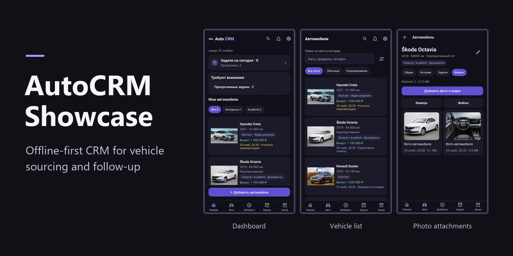
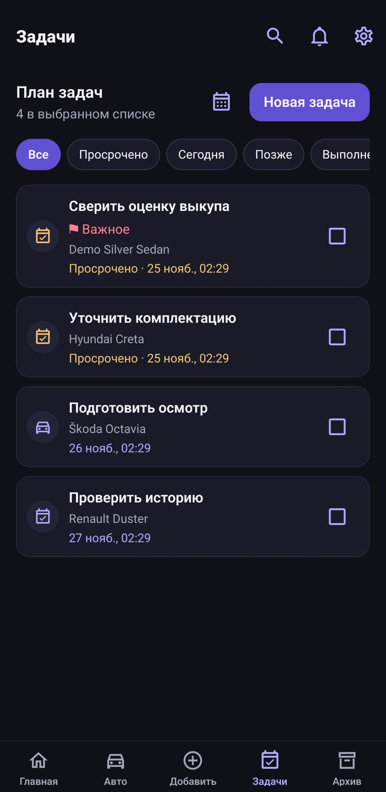
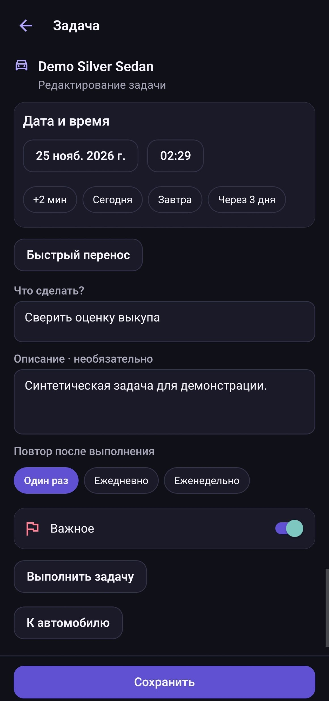
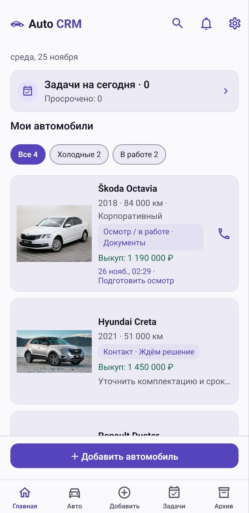
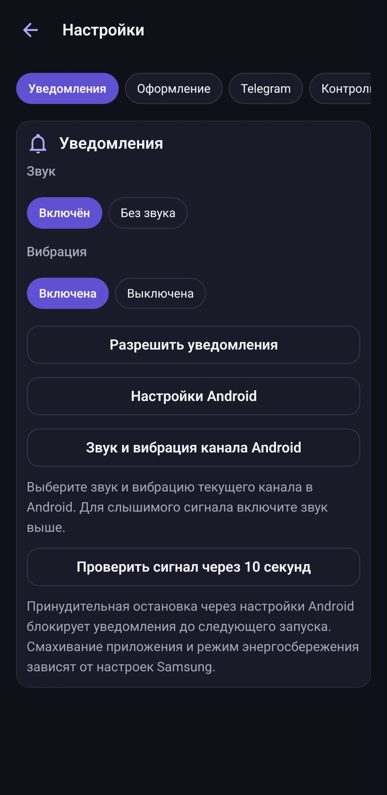
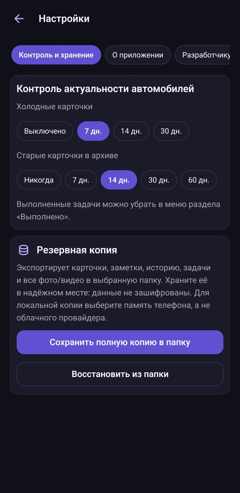
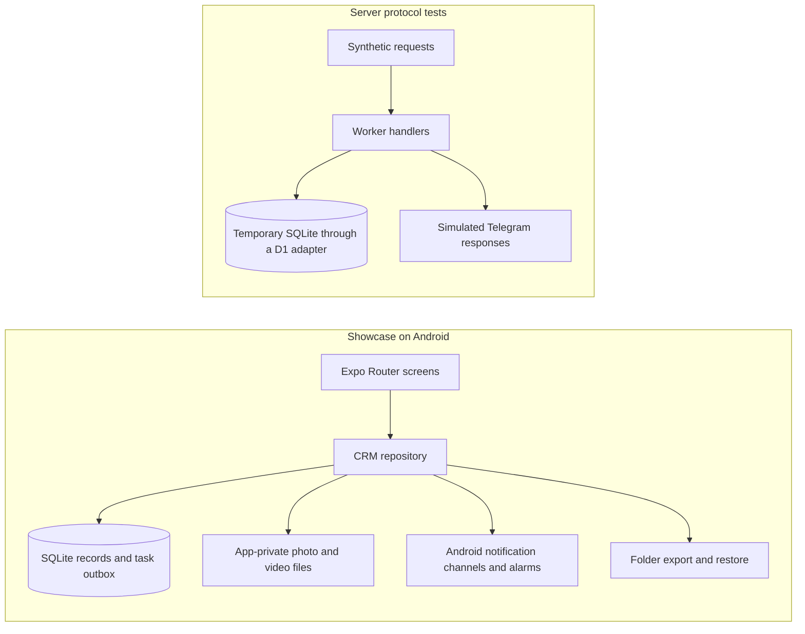

[Русский](README.md) · [**English**](README.en.md)

# AutoCRM Showcase



**Offline-first Android CRM for vehicle sourcing and follow-up.**

Vehicle sourcing involves calls, inspection photos, estimates, and reminders. When that information is spread across apps, it is easy to lose the next action. AutoCRM keeps it with the vehicle record, so it can be checked and updated during an inspection with limited connectivity.

Showcase is a portfolio edition with its own Android package and sample records. [Engineering case study](docs/CASE-STUDY.md) · [Samsung setup](docs/ANDROID-DEMO.md)

## Features

- Vehicle records with specifications, valuations, statuses, search, and filters.
- Photo and video attachments, notes, and a timeline for each vehicle.
- Tasks with rescheduling, recurrence, and local Android reminders.
- Vehicle archive, folder-based export, and validated restore.
- Light, dark, and system appearance settings.

## Gallery

These screens were captured on a Samsung running Showcase with sample records. Select an image to open the full capture.

<!-- showcase-gallery:start -->

| | |
|---|---|
| <strong>Dashboard and agenda</strong><br><a href="docs/screenshots/home-dark.png"></a> | <strong>Vehicle list and filters</strong><br><a href="docs/screenshots/vehicles-dark.png"></a> |
| <strong>Vehicle card and photos</strong><br><a href="docs/screenshots/vehicle-photos-dark.png"></a> | <strong>Notes and vehicle timeline</strong><br><a href="docs/screenshots/history-dark.png"></a> |
| <strong>Active tasks</strong><br><a href="docs/screenshots/tasks-dark.png"></a> | <strong>Scheduling and recurrence</strong><br><a href="docs/screenshots/task-edit-dark.png"></a> |
| <strong>Vehicle archive</strong><br><a href="docs/screenshots/archive-dark.png"></a> | <strong>Dashboard in light mode</strong><br><a href="docs/screenshots/home-light.png"></a> |
| <strong>Notification settings</strong><br><a href="docs/screenshots/notifications-dark.png"></a> | <strong>Backup and restore</strong><br><a href="docs/screenshots/backup-dark.png"></a> |

<!-- showcase-gallery:end -->

## Stack and architecture

React Native, Expo SDK 57, Expo Router, TypeScript, SQLite, and a project-local Expo module in Kotlin that opens Android's exact alarm settings. The repository also contains Cloudflare Worker handlers and protocol tests with a D1 adapter and a simulated Telegram transport.



SQLite stores vehicles, notes, tasks, timeline events, and settings. The [CRM repository](src/repositories/crm-repository.ts) serializes writes and groups related changes into transactions. [Migrations](src/storage/migrations.ts) preserve IDs and relationships. Photos and videos live in app-private storage. Restore verifies paths, sizes, checksums, and record relationships.

## Run locally

On Windows, use Node.js 24, npm, JDK 17, and an Android SDK with an emulator or a test device.

```powershell
npm ci
$env:APP_VARIANT = 'development'
npm run android
```

Use `npm start` to restart Metro. The development package is `com.autocrm.showcase.dev`. The standalone package is `com.autocrm.showcase` and runs without Metro. [Build the APK and import sample data](docs/ANDROID-DEMO.md)

## Checks

```powershell
npm run typecheck
npx --no-install eslint src server tests demo app.config.ts
npm test
```

On Windows the suite includes native SQLite regressions and server protocol tests with synthetic data. [CI and known dependency advisories](docs/GITHUB.md)

## Demo scope and limitations

Showcase runs locally. Live Telegram and OTA are disabled. Pairing and synchronization are exercised by isolated tests. Notification timing depends on Android permissions and power management. Folder exports are stored unencrypted. [Server tests](docs/SERVER.md) · [Changelog](CHANGELOG.md) · [Security policy](SECURITY.md)

## Licensing

**All rights reserved.** This repository is provided for portfolio review. Third-party components retain their own licenses and notices. [Terms](LICENSE.md)
