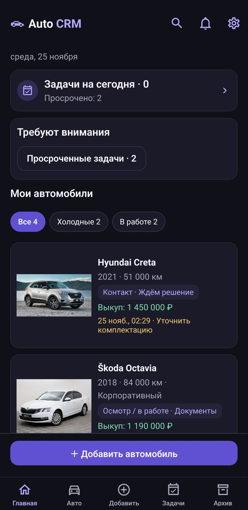
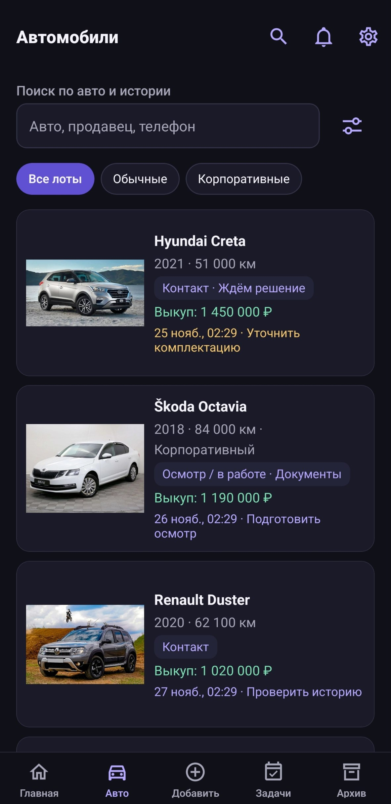
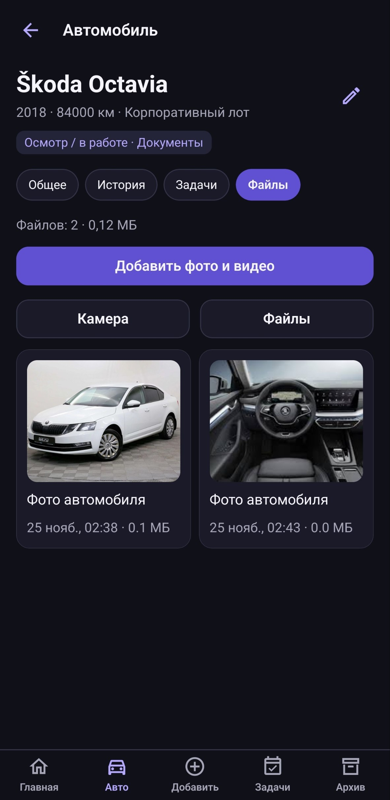
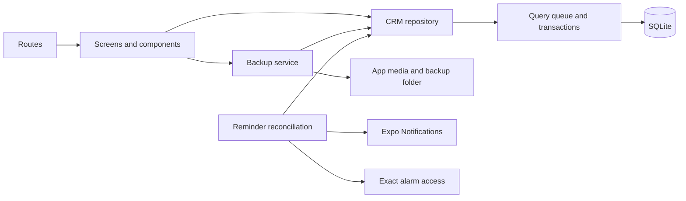
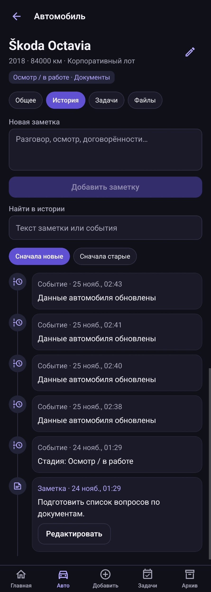
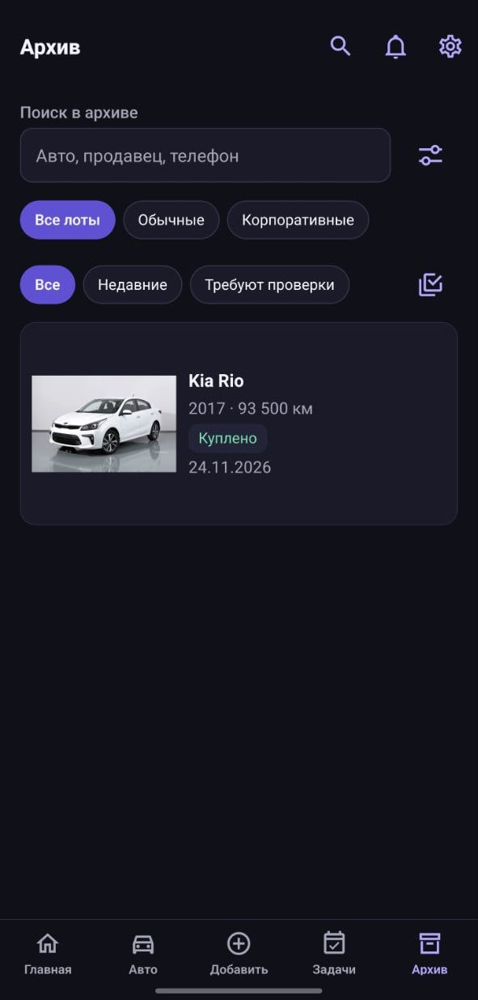

[Русский](README.md) · [**English**](README.en.md)

# AutoCRM Showcase


**A mobile CRM for vehicle sourcing, appraisal, and purchasing.**

AutoCRM keeps vehicle records, photos, notes, interaction history, tasks, and reminders in one app. Data stays on the device. Core features work without an internet connection.

Showcase is an Android demo with sample data and a Russian-language interface.

## Features

- Vehicle records with specifications, valuations, statuses, and attachments.
- Search, filters, an archive, notes, and change history.
- Tasks with rescheduling, recurrence, and local notifications.
- Folder backups and import of new vehicle records from a backup.
- Light, dark, and system appearance.

## Screenshots

| | |
| --- | --- |
| **Dashboard**<br><a href="docs/screenshots/home-dark.png"></a> | **Vehicle list**<br><a href="docs/screenshots/vehicles-dark.png"></a> |
| **Vehicle and photos**<br><a href="docs/screenshots/vehicle-photos-dark.png"></a> | **Tasks**<br><a href="docs/screenshots/tasks-dark.png"></a> |

## Technology stack

| Area | Technologies |
| --- | --- |
| Application | React Native 0.86, React 19, Expo SDK 57, Expo Router, TypeScript |
| Android and storage | SQLite, Kotlin and Expo Modules API, Expo Notifications, Expo SecureStore |
| Server protocol | Cloudflare Workers and D1. Tests simulate Telegram delivery |
| Verification | Node.js Test Runner, sql.js, ESLint, GitHub Actions |

## Architecture



Screens use a repository that runs SQLite queries through a shared queue. Related writes run in transactions. Migrations update the schema while preserving record IDs and relationships. The app stores its reminder queue in SQLite and reconciles it with the notifications scheduled on Android. The server protocol supports task revisions and acknowledgements. Live Telegram is disabled in Showcase.

Media files live in the app's storage directory. On import, the backup service validates the manifest and checks the files being restored. It adds vehicles with new IDs and their related records. Existing vehicle records are preserved.

## Project structure

```text
src/
  app/           Routes and navigation
  screens/       CRM screens
  components/    Shared UI
  domain/        Domain types and rules
  repositories/  Vehicle, task, and history operations
  services/      Media, backups, reminders, and sync protocol
  storage/       SQLite connection, transactions, and migrations
modules/         Local Android module in Kotlin
server/          Worker handlers and D1 migrations
tests/           Automated tests
```

## Run locally

On Windows, use Node.js 24, npm, Git, PowerShell 7.2 or later, JDK 17, Android Studio, and the Android SDK. Set up an emulator or an Android device with USB debugging. The initial dependency installation and build require an internet connection.

```powershell
git clone https://github.com/DKI62/AutoCRM-Showcase.git
cd AutoCRM-Showcase
npm ci
$env:APP_VARIANT = 'development'
npm run android
```

Run `npm start` to restart Metro. Use a development build to exercise the full Android feature set. Expo Go lacks the app's exact alarm module. [Android guide](docs/ANDROID.en.md)

## Testing and CI

```powershell
npm run typecheck
npx --no-install eslint src server tests demo app.config.ts
npm test
```

The ESLint command matches the CI scope. `npm run lint` uses Expo lint with a narrower scope. The suite uses sql.js and runs additional queries against Windows system SQLite using PowerShell 7. [GitHub Actions](https://github.com/DKI62/AutoCRM-Showcase/actions/workflows/ci.yml)

## More screenshots

| | |
| --- | --- |
| **Notes and history**<br><a href="docs/screenshots/history-dark.png"></a> | **Scheduling and recurrence**<br><a href="docs/screenshots/task-edit-dark.png"></a> |
| **Archive**<br><a href="docs/screenshots/archive-dark.png"></a> | **Light theme**<br><a href="docs/screenshots/home-light.png"></a> |
| **Notification settings**<br><a href="docs/screenshots/notifications-dark.png"></a> | **Backup settings**<br><a href="docs/screenshots/backup-dark.png"></a> |

## Documentation

- [Engineering case study](docs/CASE-STUDY.en.md).
- [Android build and sample data](docs/ANDROID.en.md).
- [Server protocol and local checks](docs/SERVER.en.md).
- [Security and known advisories](SECURITY.en.md).
- [Changelog](CHANGELOG.en.md).

## Limitations

Showcase targets Android. Live Telegram and Expo OTA updates are disabled. Reminder delivery depends on Android permissions and power management. Exported backups are unencrypted.

## Licensing

**All rights reserved** for original AutoCRM Showcase materials. Third-party components retain their respective licenses. [Terms and notices](LICENSE.md)
