[**Русский**](README.md) · [English](README.en.md)

# AutoCRM Showcase

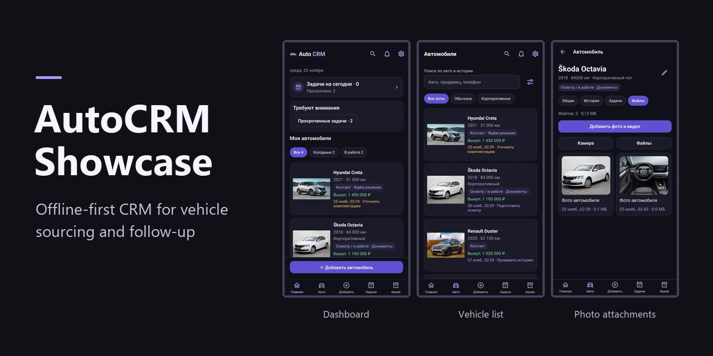

**Мобильная CRM для подбора, оценки и выкупа автомобилей.**

AutoCRM объединяет карточки автомобилей, фотографии, заметки, историю взаимодействий, задачи и напоминания в одном приложении. Данные хранятся локально на устройстве. Основные функции доступны без подключения к интернету.

Showcase — демонстрационная версия для Android с тестовыми данными и русскоязычным интерфейсом.

## Основные возможности

- Карточки автомобилей с характеристиками, оценками, статусами и вложениями.
- Поиск, фильтры, архив, заметки и история изменений.
- Задачи с переносом срока, повторениями и локальными уведомлениями.
- Резервное копирование в папку и импорт новых карточек из копии.
- Светлая, тёмная и системная темы.

## Скриншоты

| | |
| --- | --- |
| **Главная**<br><a href="docs/screenshots/home-dark.png">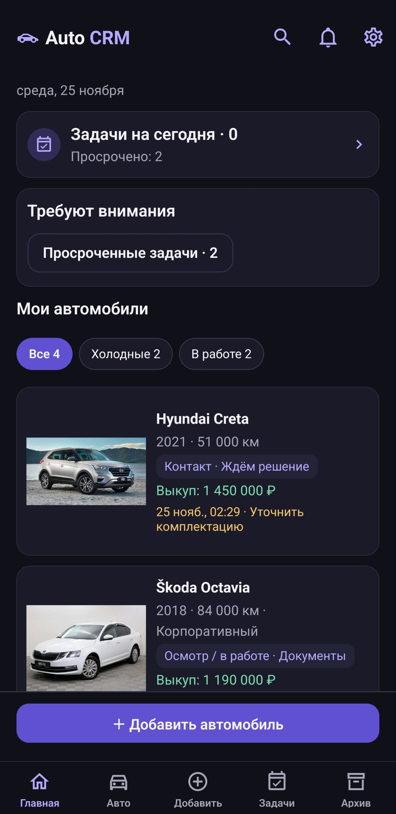</a> | **Список автомобилей**<br><a href="docs/screenshots/vehicles-dark.png">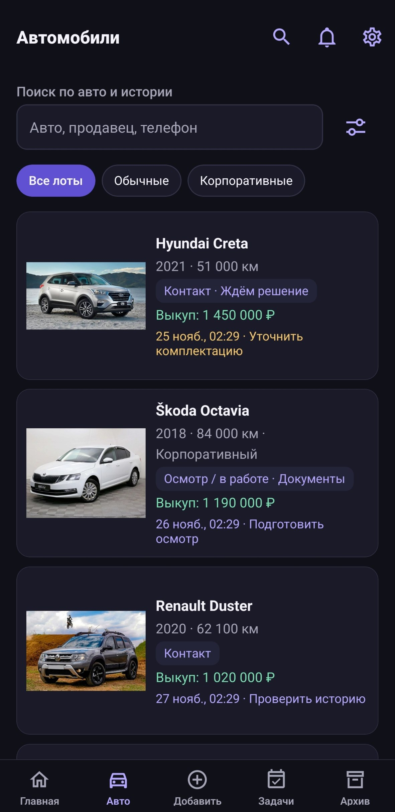</a> |
| **Карточка и фотографии**<br><a href="docs/screenshots/vehicle-photos-dark.png">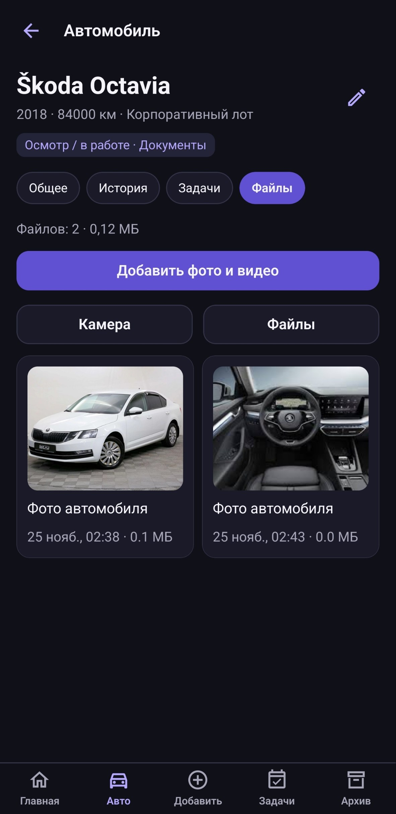</a> | **Задачи**<br><a href="docs/screenshots/tasks-dark.png">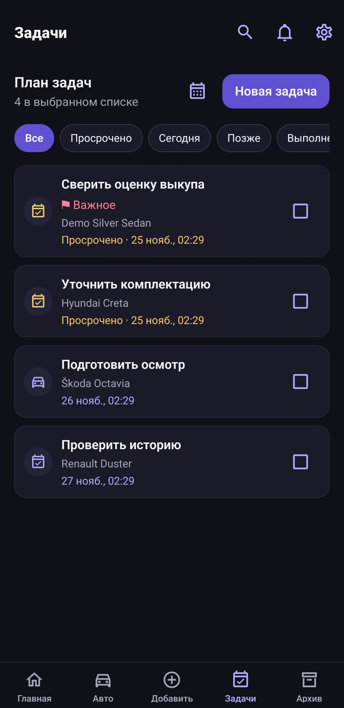</a> |

## Технологический стек

| Область | Технологии |
| --- | --- |
| Приложение | React Native 0.86, React 19, Expo SDK 57, Expo Router, TypeScript |
| Android и хранение | SQLite, Kotlin и Expo Modules API, Expo Notifications, Expo SecureStore |
| Серверный протокол | Cloudflare Workers и D1. Доставка в Telegram имитируется в тестах |
| Проверки | Node.js Test Runner, sql.js, ESLint, GitHub Actions |

## Архитектура

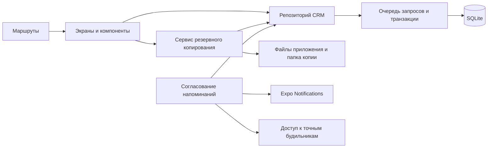

Экраны работают с репозиторием, который ставит запросы SQLite в одну очередь. Связанные записи сохраняются в транзакции. Миграции обновляют схему с сохранением идентификаторов и связей. Очередь напоминаний хранится в базе и согласуется с зарегистрированными уведомлениями Android. Для серверного протокола предусмотрены версии задач и подтверждения обмена. Сетевой Telegram в Showcase отключён.

Медиафайлы хранятся в каталоге приложения. При импорте сервис проверяет структуру копии и целостность восстанавливаемых файлов. Добавляются карточки с отсутствующими идентификаторами и их связанные записи. Существующие карточки сохраняются.

## Структура проекта

```text
src/
  app/           Маршруты и навигация
  screens/       Экраны CRM
  components/    Общие элементы интерфейса
  domain/        Модели и правила предметной области
  repositories/  Операции с карточками, задачами и историей
  services/      Медиа, копии, напоминания и протокол обмена
  storage/       Подключение SQLite, транзакции и миграции
modules/         Локальный модуль Android на Kotlin
server/          Обработчики Worker и миграции D1
tests/           Автоматические проверки
```

## Локальный запуск

Для запуска на Windows нужны Node.js 24, npm, Git, PowerShell 7.2 или новее, JDK 17, Android Studio и Android SDK. Подготовьте эмулятор или устройство Android с USB-отладкой. Первичная установка зависимостей и сборка требуют подключения к интернету.

```powershell
git clone https://github.com/DKI62/AutoCRM-Showcase.git
cd AutoCRM-Showcase
npm ci
$env:APP_VARIANT = 'development'
npm run android
```

Для повторного запуска Metro выполните `npm start`. Для проверки всех возможностей Android используйте сборку для разработки (Development Build): Expo Go не включает локальный модуль точных будильников. [Руководство по Android](docs/ANDROID.md)

## Тестирование и CI

```powershell
npm run typecheck
npx --no-install eslint src server tests demo app.config.ts
npm test
```

Команда ESLint проверяет те же файлы, что и CI. `npm run lint` запускает Expo lint с меньшим охватом. Тесты используют sql.js, а дополнительная проверка запросов выполняется на системной SQLite в Windows с PowerShell 7. [GitHub Actions](https://github.com/DKI62/AutoCRM-Showcase/actions/workflows/ci.yml)

## Остальная галерея

| | |
| --- | --- |
| **Заметки и история**<br><a href="docs/screenshots/history-dark.png">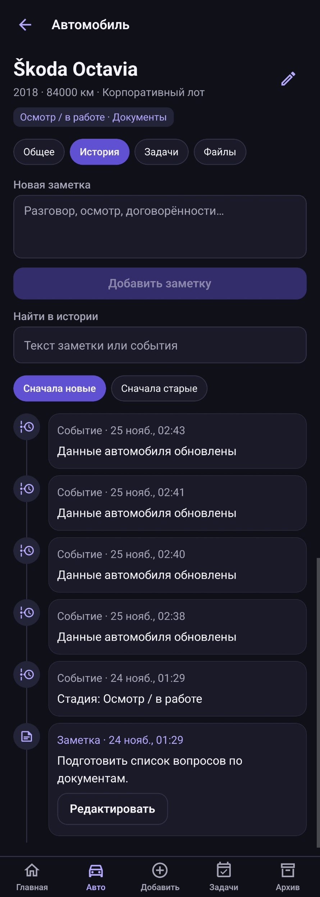</a> | **Сроки и повторения**<br><a href="docs/screenshots/task-edit-dark.png">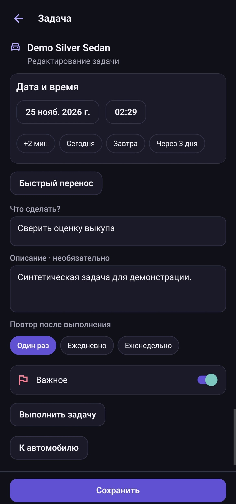</a> |
| **Архив**<br><a href="docs/screenshots/archive-dark.png">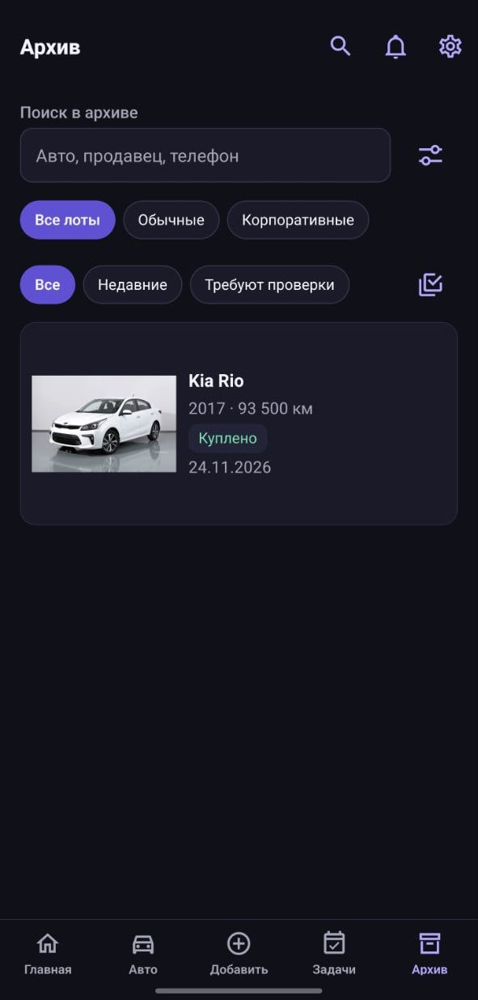</a> | **Светлая тема**<br><a href="docs/screenshots/home-light.png">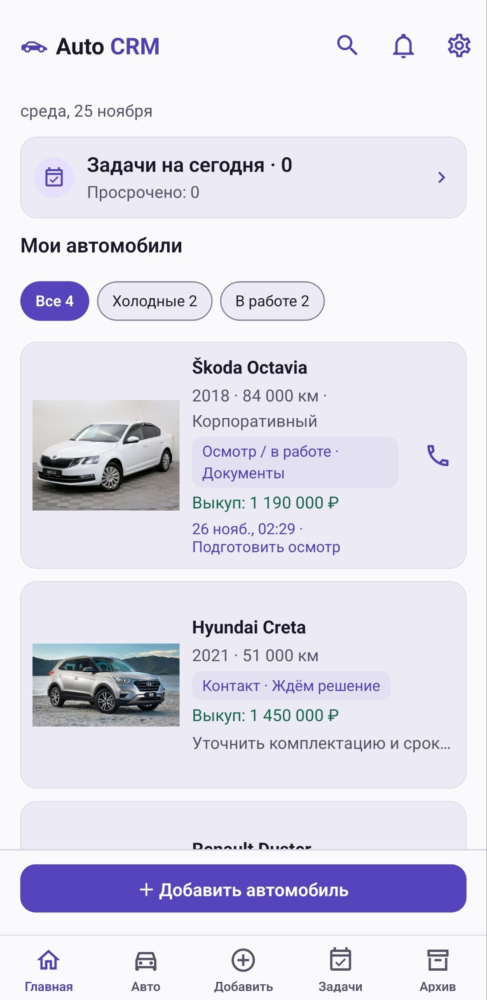</a> |
| **Настройки уведомлений**<br><a href="docs/screenshots/notifications-dark.png">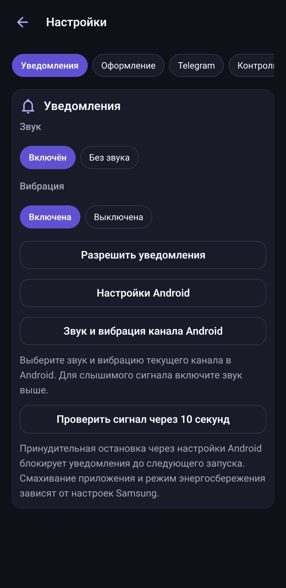</a> | **Резервное копирование**<br><a href="docs/screenshots/backup-dark.png">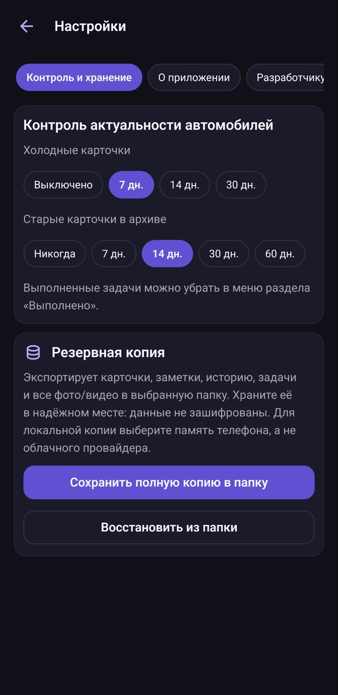</a> |

## Документация

- [Инженерный кейс](docs/CASE-STUDY.md).
- [Сборка Android и демонстрационные данные](docs/ANDROID.md).
- [Серверный протокол и локальные проверки](docs/SERVER.md).
- [Безопасность и известные уязвимости](SECURITY.md).
- [История изменений](CHANGELOG.md).

## Ограничения

Showcase предназначен для Android. Сетевой Telegram и обновления Expo OTA отключены. Доставка напоминаний зависит от разрешений и энергосбережения Android. Экспортируемые копии хранятся без шифрования.

## Лицензирование

**All rights reserved** для оригинальных материалов AutoCRM Showcase. Для сторонних компонентов действуют их лицензии. [Условия и уведомления](LICENSE.md)
