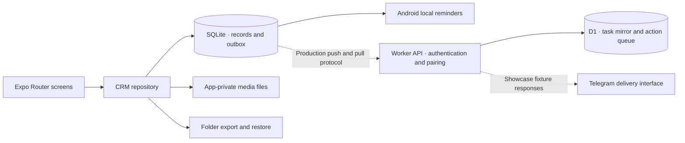

# Auto CRM

**Offline-first Android CRM for automotive professionals.**

A custom client project built through independent software development. It supports the daily work around vehicle leads, inspections, follow-ups and archiving. The portfolio edition preserves the application and the server protocol with synthetic data and isolated configuration.

[Русская версия](README.ru.md) · [Engineering case study](docs/CASE-STUDY.md) · [Demo capture guide](docs/screenshots/README.md)

## Features

- Vehicle records with prices, specification, linked tasks, notes, activity history and attachments.
- Daily agenda, recurring follow-ups, archive, search and filters.
- Android local reminders using notification channels and exact alarms when granted. In-app records remain available offline.
- Folder-based backup and restore, media import and a choice of light, dark or system appearance.

## Gallery

The [capture plan](docs/screenshots/README.md) covers the home screen, list, vehicle detail, forms, tasks, archive, settings and both themes. Genuine Android captures from the isolated Showcase package are pending.

## Stack and architecture

React Native, Expo SDK 57, Expo Router and strict TypeScript on Android. SQLite stores CRM records. Expo SecureStore handles binding credentials in the deployed edition. The custom Expo Android module opens system settings for exact alarms. Cloudflare Workers, D1 and the Telegram Bot API form the original companion service. Showcase executes the server protocol with an injected fixture transport.



The [repository](src/repositories/crm-repository.ts) serializes local writes through a transactional store. [SQLite migrations](src/storage/migrations.ts) preserve existing IDs and relationships. Media files live separately from the database and backup manifests validate paths and file metadata before restoration.

## Synchronization and security

The deployed mobile protocol uploads a revisioned task projection and pulls device-scoped actions. The local outbox retains changes until the server accepts them. Pairing v2 stages a candidate first and binds it only after the phone confirms a code from the chat. Existing authorized devices can continue through the migration. The [server guide](docs/SERVER.md) describes local protocol tests and the boundary around real delivery.

## Run locally

Use Node.js 22, npm, a JDK and an Android SDK with an emulator or an isolated device. Android SDK setup follows the Expo local build documentation. The native alarm module requires a development build.

```powershell
npm ci
$env:APP_VARIANT = 'development'
npm run android
```

After installation, use `npm start` to restart Metro if needed. The dev package is `com.autocrm.showcase.dev`. The separate Showcase package is `com.autocrm.showcase`. OTA is disabled. An opt-in [synthetic backup generator](docs/screenshots/README.md) prepares sample records without contacting external services.

## Checks

```powershell
npm run typecheck
npm run lint
npm test
npx expo-doctor
```

## Status and use

This is a source portfolio edition of the 1.0.0 Android project. Live Telegram connections and OTA are disabled here. Local notification timing depends on Android permissions and system scheduling. See [release notes](CHANGELOG.md) and the [security policy](SECURITY.md).

The source is presented for portfolio review. No open-source license has been granted. Third-party dependencies remain subject to their own licenses.
