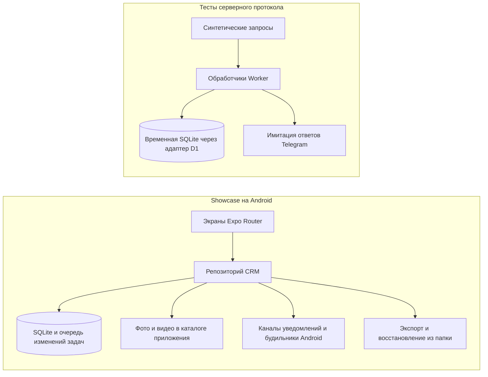

[**Русский**](README.md) · [English](README.en.md)

# AutoCRM Showcase


**Автономная Android CRM для подбора и оценки автомобилей.**

В работе с автомобилем легко потерять договорённости, фотографии осмотра и срок следующего звонка, если они лежат в разных приложениях. AutoCRM собирает их в карточке автомобиля. Информацию можно открыть и обновить без связи, например во время осмотра.

Showcase — портфолио-версия с отдельным Android-пакетом и демонстрационными данными. [Инженерный кейс](docs/CASE-STUDY.md) · [Запуск на Samsung](docs/ANDROID-DEMO.md)

## Возможности

- Карточки автомобилей с характеристиками, оценками, статусами, поиском и фильтрами.
- Фото и видео, заметки и история изменений по автомобилю.
- Задачи, перенос сроков, повторения и локальные напоминания Android.
- Архив автомобилей, экспорт и восстановление из папки.
- Светлая, тёмная и системная темы.

## Галерея

Кадры сняты на Samsung в Showcase с демонстрационными записями. Нажмите на изображение, чтобы открыть его в полном размере.

<!-- showcase-gallery:start -->

| | |
|---|---|
| <strong>Главная и план дня</strong><br><a href="docs/screenshots/home-dark.png"></a> | <strong>Автомобили и фильтры</strong><br><a href="docs/screenshots/vehicles-dark.png"></a> |
| <strong>Карточка и фотографии</strong><br><a href="docs/screenshots/vehicle-photos-dark.png"></a> | <strong>Заметки и история</strong><br><a href="docs/screenshots/history-dark.png"></a> |
| <strong>Активные задачи</strong><br><a href="docs/screenshots/tasks-dark.png"></a> | <strong>Сроки и повторения</strong><br><a href="docs/screenshots/task-edit-dark.png"></a> |
| <strong>Архив автомобилей</strong><br><a href="docs/screenshots/archive-dark.png"></a> | <strong>Главная в светлой теме</strong><br><a href="docs/screenshots/home-light.png"></a> |
| <strong>Настройки уведомлений</strong><br><a href="docs/screenshots/notifications-dark.png"></a> | <strong>Экспорт и восстановление</strong><br><a href="docs/screenshots/backup-dark.png"></a> |

<!-- showcase-gallery:end -->

## Стек и архитектура

React Native, Expo SDK 57, Expo Router, TypeScript, SQLite и локальный модуль Expo на Kotlin для открытия настроек точных будильников Android. В репозитории также есть обработчики Cloudflare Worker и тесты протокола с адаптером D1 и имитацией Telegram.



SQLite хранит карточки, заметки, задачи, события и настройки. [Репозиторий CRM](src/repositories/crm-repository.ts) последовательно выполняет записи и объединяет связанные изменения в транзакции. [Миграции](src/storage/migrations.ts) сохраняют идентификаторы и связи. Фото и видео хранятся в каталоге приложения. При восстановлении проверяются пути, размеры, контрольные суммы и связи записей.

## Локальный запуск

Для сборки на Windows нужны Node.js 24, npm, JDK 17 и Android SDK, а также эмулятор или тестовое устройство.

```powershell
npm ci
$env:APP_VARIANT = 'development'
npm run android
```

Для последующих запусков Metro используйте `npm start`. Пакет Development Build — `com.autocrm.showcase.dev`. Автономный Showcase использует `com.autocrm.showcase` и запускается без Metro. [Сборка APK и импорт демоданных](docs/ANDROID-DEMO.md)

## Проверки

```powershell
npm run typecheck
npx --no-install eslint src server tests demo app.config.ts
npm test
```

На Windows тесты включают регрессии на системной SQLite и сценарии серверного протокола на синтетических данных. [CI и известные замечания по зависимостям](docs/GITHUB.md)

## Демонстрационный режим и ограничения

Showcase работает локально. В этой редакции сетевой Telegram и OTA отключены. Привязка и синхронизация проверяются в изолированных тестах. Доставка уведомлений зависит от разрешений Android и настроек энергосбережения. Резервные копии в папке хранятся без шифрования. [Серверные тесты](docs/SERVER.md) · [Изменения](CHANGELOG.md) · [Политика безопасности](SECURITY.md)

## Лицензирование

**All rights reserved.** Исходники предоставляются для ознакомления с портфолио. Лицензии и уведомления сторонних компонентов действуют отдельно. [Условия использования](LICENSE.md)
